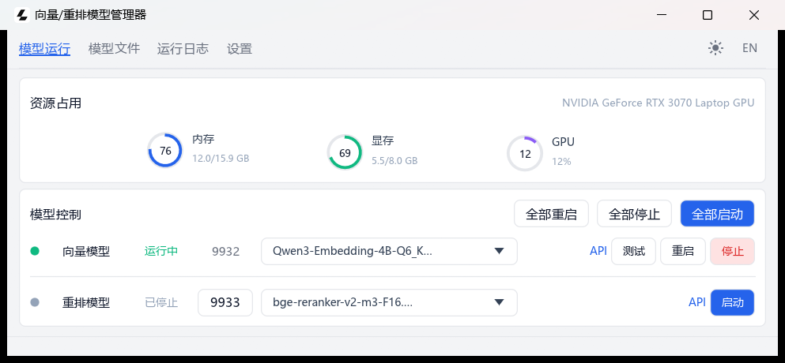

<p align="center">
  
</p>

<h1 align="center">向量/重排模型管理器</h1>

<p align="center">
  轻量 · 低占用 · 快启动 · 全程离线
</p>

一个轻量的本地检索模型启动器：Rust + egui 桌面程序（单个 exe），直接拉起并守护 llama.cpp 的
`llama-server` 进程。只管理两类模型：文本向量化（embedding）与检索重排（rerank）。
模型和运行时都在本机，无需联网，也不依赖 Ollama。

> A lightweight Windows launcher for local embedding and reranker models running on llama.cpp.

<p align="center">
  
</p>

## 功能

- 一键启动 / 停止 / 重启向量与重排模型，显示状态、PID 与健康检查结果
- 按类型选择 GGUF 模型；导入前预检（GGUF 真伪 / 磁盘空间），可取消，同名冲突可覆盖或另存为
- 导入完成后自动识别并分配；已有选择时先确认，不静默覆盖
- 模型可导出到任意目录（后台复制、可取消）；运行中的模型也允许导出
- 模型文件页显示类型、大小与向量维度；移除导入不删除磁盘文件，可恢复
- 实时日志、资源占用圆环、系统托盘
- 亮色 / 暗色主题与中文 / English 切换，设置自动保存

## 资源占用采样

- 内存：所有 Windows 设备都可用
- 显存 / GPU 利用率：优先调用 NVIDIA 的 `nvidia-smi`；没有时回退到 Windows 自带的
  「GPU Engine / GPU Adapter Memory」性能计数器，AMD、Intel 显卡同样可以显示利用率与显存占用
- 走性能计数器兜底且无法识别显卡型号时，显存总量显示为「—」，只显示已用显存
- 两者都拿不到数据时才显示「未检测到」

## 模型

| 模型 | 接入模型名 | 默认端口 | 接口 | 默认文件 |
|---|---|---|---|---|
| 向量 embedding | `Qwen3-Embedding-4B-Q6_K` | 9932 | `POST /v1/embeddings` | `Qwen3-Embedding-4B-Q6_K.gguf` |
| 重排 rerank | `bge-reranker-v2-m3-F16` | 9933 | `POST /v1/rerank` | `bge-reranker-v2-m3-F16.gguf` |

两个模型都基于 llama.cpp（llama-server），仅监听 `127.0.0.1`。接入模型名为所选 GGUF 文件名去掉
`.gguf`，启动时通过 `--alias` 同步给 llama-server。

> 只管理向量与重排两类模型。对话、VLM、翻译等生成式模型即使放在模型目录里也只会显示为
> `Other`、不进入服务行 —— 这是有意的范围限制，不是识别遗漏（见
> [产品定位](docs/positioning.md)）。

## 快速开始

```bat
:: 1. 安装 Llama 桌面端，确保 llama.exe 可用
:: 2. 把两个 GGUF 模型放到程序目录
:: 3. 启动 GUI
start-gui.cmd
```

从源码构建（仓库根即本目录）：

```bat
cargo build --release
copy target\release\llama-rag-gui.exe ..\
```

模型 `.gguf`、`config.json` 与发布用的 `llama-rag-gui.exe` 在**上一级目录**，程序启动时从 exe 所在目录
加载模型，所以发布时要先把 exe 复制到上一级。

详见 [安装与运行](docs/getting-started.md)。

## 文档

- [产品定位与范围](docs/positioning.md)
- [安装与运行](docs/getting-started.md)
- [模型管理](docs/models.md)
- [API 与接入](docs/api.md)
- [配置说明](docs/configuration.md)
- [常见问题](docs/troubleshooting.md)
- [开发说明](docs/development.md)

---

图标来源：[llama.app](https://llama.app/)。
